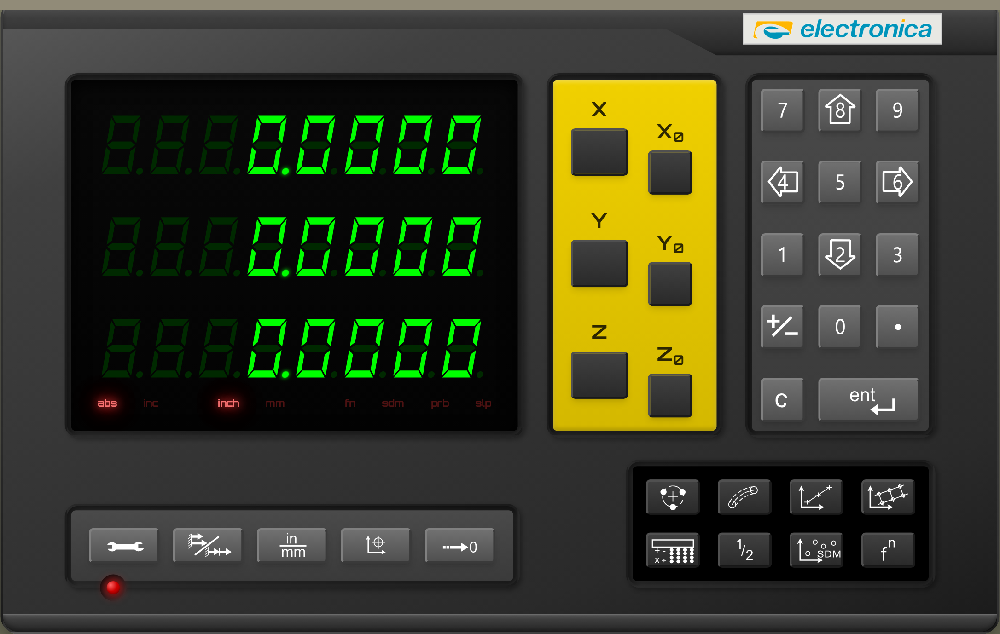

# EL400 Digital Readout (DRO) Simulator

A web-based simulator of the Electronica EL400 milling-machine digital readout.

**Live version**: [el400.vza.net](https://el400.vza.net)



## Overview

The simulator provides a DRO-style interface for manual milling alongside a
[pendant controller](https://github.com/pedropaulovc/whb04b-6). It runs standalone
or connects to [CNCjs](https://github.com/cncjs/cncjs) for live machine position
and probe state.

Features include ABS/INC datums, sub-datum memory, calculator and trigonometry,
center finding, taper calculations, hole patterns, calibration, and simulated
probe/output/serial workflows. The [48 user stories](project/user-stories/README.md)
define the supported behavior and its verification limits.

The interface includes keyboard navigation, screen-reader semantics, and
forced-colors support ([accessibility details](ACCESSIBILITY.md)). Browser
semantics and desktop layouts have been exercised; physical touchscreen
ergonomics and screen-reader speech have not been validated.

## Project Info

**Lovable project URL**: https://lovable.dev/projects/269190d5-da7b-4375-80fd-1a9891f19e6a

## Deployment

Cloudflare Workers hosts the production build and isolated pull-request builds:

| Target | Trigger | Worker | Direct URL |
| --- | --- | --- | --- |
| Production | Push to `main` or manual workflow dispatch | `el400` | [el400.el400-vza-net-prod.workers.dev](https://el400.el400-vza-net-prod.workers.dev) |
| Pull request `N` | Open, update, or reopen a same-repository PR | `el400-pr-N` | `https://el400-pr-N.el400-ppe-vza-net.workers.dev` |

Closing or merging a pull request deletes its Worker. Pull requests from forks do
not receive Cloudflare credentials and therefore do not get a deployment.

The public production URL, [el400.vza.net](https://el400.vza.net), and the shared
PPE URL, [el400.ppe.vza.net](https://el400.ppe.vza.net), pass through the
[`vza-net-router`](https://github.com/pedropaulovc/vza-net-router) account bridge
before reaching the Workers in the isolated EL400 accounts. The shared
`el400-ppe` Worker backs the PPE URL; PR deployments do not overwrite it.

GitHub environments `cloudflare-production` and `cloudflare-ppe` provide each
workflow with its target account ID and API token. `wrangler.toml` remains
account-neutral so the same static-assets configuration works in both accounts.

## Tech Stack

- Vite
- TypeScript
- React
- Tailwind CSS

## Getting Started

### Prerequisites

- Node.js & npm - [install with nvm](https://github.com/nvm-sh/nvm#installing-and-updating)

### Installation

```sh
# Clone the repository
git clone https://github.com/pedropaulovc/el400.git

# Navigate to the project directory
cd el400

# Install dependencies
npm ci

# Start development server
npm run dev
```

## Standalone Debug Mode

Open `/?source=debug` to use the in-browser machine without CNCjs. The debug panel
sets physical X/Y/Z positions in millimetres and supplies probe, encoder-signal,
and jog controls. Crossing its physical +10 mm reference mark in either direction
produces a simulated reference event.

Debug encoders model an installed 5 µm scale, so changing `SC` changes decoded
travel. CNCjs already supplies engineering millimetres and is not rescaled by `SC`.
Setup edits remain drafts until Enter at `SAU CHG`. Leaving setup through `C` or
`End` discards unsaved edits; `C` inside a nested editor first backs out of it.
A settings-schema version change resets stored setup configuration to defaults.
SDM points, work datums, machine-reference offsets, output programs, and output
count persist separately from the OEM settings baseline.
`rSt oEm` restores only the selected axis's configuration, preserving global
settings, other axes, and operator data. A scale/calibration change invalidates
that axis's active reference; a scale change also rescales its saved reference offset.

The auxiliary panel exposes six logical output levels and a virtual serial terminal.
In a secure context (HTTPS or localhost) with Web Serial support, its physical-port
control requests permission and opens 9600 baud, 8N1, with no flow control.
The physical serial path has not been hardware-tested. Logical-output simulation
does not drive electrical output pins.
Angular readouts report `Pc fail` without transmitting: the documented serial
format defines MM/Inch flags but no angular encoding.

## Using with CNCjs

The DRO receives live `controller:state` updates from
[CNCjs](https://github.com/cncjs/cncjs) over Socket.IO v2 (CNCjs 1.x).
It has position parsers for GRBL, GrblHAL, TinyG/g2core, Smoothie, and Marlin.
Probe-state availability depends on the controller's payload; Smoothie and
Marlin do not provide the realtime probe fields used here.

Headed verification used GRBL-like traffic from a dedicated mock CNCjs service,
including reconnect and iframe behavior. Physical controllers and CNCjs's own
workspace UI were not exercised.

### 1. Install and run CNCjs

```sh
# Install CNCjs globally
npm install -g cncjs

# Start it (defaults to http://localhost:8000)
cncjs
```

In CNCjs, choose the serial port and controller and open the connection first.
The DRO normally joins the first port CNCjs reports as already in use.

### 2. Build the DRO and serve it from CNCjs

Build the app with a base path, then mount the build into CNCjs so it is served
same-origin (this avoids cross-origin and mixed-content issues behind HTTPS
proxies):

```sh
# Build with the path it will be mounted at
npm install
npm run build -- --base=/el400/

# Serve the build at /el400 alongside CNCjs
cncjs --mount /el400:/absolute/path/to/el400/dist
```

The DRO is now available at `http://localhost:8000/el400/`.

### 3. Add it as a custom widget

1. In the CNCjs workspace, open the **≡ Manage Widgets** menu and enable
   **Custom Widget**.
2. On the new widget, click the **⚙ (Edit)** icon and set:
   - **Title**: `EL400 DRO`
   - **URL**: `/el400/?source=cncjs`
3. Toggle the widget **Enable** control. CNCjs appends its auth token to the
   iframe URL. The DRO forwards it and attempts to join the first active port
   (or the explicit `serialport`).

### Standalone window

You can also open the DRO in its own tab. When served same-origin via
`--mount`, no host/port is needed:

```
http://localhost:8000/el400/?source=cncjs&token=<CNCjs session token>
```

For another origin, pass `host` and `port` as needed and configure CNCjs for
remote access. Use an HTTPS origin when the DRO page is HTTPS; bare hostnames
are converted to HTTP. For standalone authentication, supply `token` when
required by the CNCjs server.

### Query parameters

| Parameter    | Description                                                                                 |
| ------------ | ------------------------------------------------------------------------------------------- |
| `source`     | Set to `cncjs` to use the CNCjs adapter.                                                     |
| `host` | Omit for the page's origin. Accepts a bare hostname (HTTP) or a scheme-qualified origin. |
| `port` | Defaults to `8000`; ignored when `host` is omitted or a scheme-qualified host already contains a numeric port. |
| `token` | Forwarded to Socket.IO when present. CNCjs supplies it to custom widgets; standalone requirements depend on server authentication. |
| `serialport` | Explicit port for a CNCjs `open` request using Grbl/115200. Omit to discover the first already-in-use port. |

Tests also use `sessionId` for mock-server isolation; normal CNCjs connections
do not need it. The adapter reconnects and repeats port discovery after a
disconnect; removing the widget/iframe closes its connection.

For implementation details, see the CNCjs adapter in [`src/adapters/CncjsMillAdapter.ts`](src/adapters/CncjsMillAdapter.ts).


## DRO Specifications

Hardware-defined behavior follows these public sources, in precedence order:

1. [EL400 Operation Manual](https://www.dropros.com/documents/EL400%20OpManual.pdf)
2. [DROPROS EL400 video walkthrough](https://www.youtube.com/watch?v=7W47KPCu7jE)
3. [MagXact MX-100M Manual](https://cdn.shopify.com/s/files/1/0576/0984/6859/files/MagXact-MX-100M-Mill-DRO-V1-9-1-2021.pdf?v=1740669616)

Browser, accessibility, integration, and simulator-only policies are identified
as project contracts where the manuals are silent. The
[48 user stories](project/user-stories/README.md) record citations, acceptance
criteria, and [verification evidence](project/user-stories/README.md#verification).
Only the [Deliberately Out of Scope](project/user-stories/README.md#deliberately-out-of-scope)
list is excluded; calibration, taper, six-output, and serial behavior remain in scope.

## License

MIT License - see LICENSE file for details
