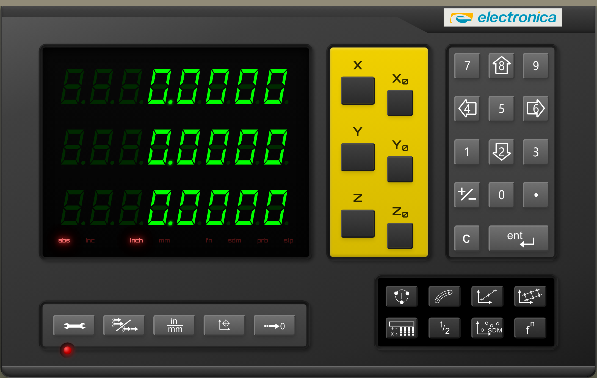
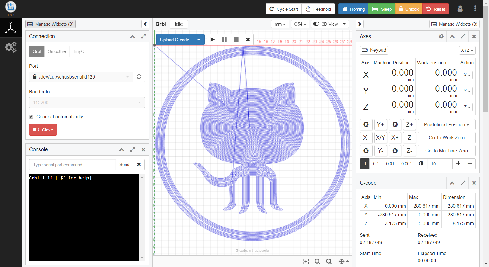
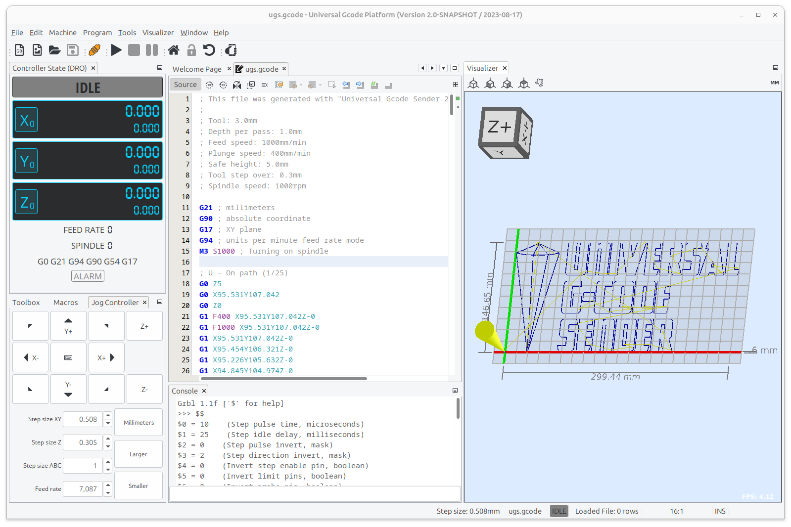

# EL400 Digital Readout (DRO) Simulator

A faithful web-based simulator for the Electronica EL400 (a.k.a. MagXact MX-100M) digital readout (DRO) system.

**Live version**: [el400.vza.net](https://el400.vza.net)



## Overview

CNC milling machine users sometimes need to operate their machines in fully manual mode, using a [pendant controller](https://github.com/pedropaulovc/whb04b-6) for precise jogging and positioning. However, current G-code sender applications are not optimized for this workflow.

### The Problem with Current G-Code Senders

Popular G-code senders like [CNCjs](https://github.com/cncjs/cncjs) and [Universal Gcode Sender (UGS)](https://github.com/winder/Universal-G-Code-Sender) are designed primarily for mouse and keyboard interaction. Their interfaces are cramped and difficult to use on touch screens:

| CNCjs | Universal Gcode Sender |
|-------|------------------------|
|  |  |
| *Dense UI with small buttons* | *Complex panels optimized for desktop* |

More importantly, these G-code senders lack essential machinist calculator functions that traditional DRO units provide out of the box:

| Feature | EL400 DRO | CNCjs | UGS |
|---------|-----------|-------|-----|
| Half Function (centerline finding) | Yes | No | No |
| Built-in Calculator | Yes | No | No |
| Bolt Hole Circle | Yes | No | No |
| Bolt Hole Arc | Yes | No | No |
| Linear Hole Patterns | Yes | No | No |
| Grid Patterns | Yes | No | No |
| Center of Circle (3-point) | Yes | No | No |
| Center of Line | Yes | No | No |
| Arc Contouring | Yes | No | No |
| Taper Calculations | Yes | No | No |
| Distance to Go | Yes | Partial | Partial |
| Sub-Datum Memory | Yes | No | No |

### The Solution

This project recreates the EL400/MX-100M DRO interface as a web application, designed to be integrated with G-code senders. When displayed maximized on a touch screen alongside a pendant controller, it provides ergonomics equivalent to manual milling machines equipped with a traditional DRO unit.

The simulator focuses on:
- **Touch-friendly interface**: Large buttons and displays optimized for shop floor use
- **Complete machinist functions**: All the calculator features machinists expect from a DRO
- **CNC integration**: Connect to CNCjs or other G-code senders for live position display
- **Accessibility**: WCAG compliance, keyboard navigation, screen reader support, forced-colors mode ([details](ACCESSIBILITY.md))
- **Accurate reproduction**: Faithful recreation of the original hardware's behavior

## npm distribution

The `el400` package contains a prebuilt simulator in `web/`, configured for a
`/el400/` URL prefix. It has no runtime npm dependencies and does not expose a
React API or CLI.

```sh
npm install --save-exact el400@0.2.0
```

Mount `node_modules/el400/web` as static files at `/el400/` in CNCjs, then add
`/el400/?source=cncjs` as a custom widget. Keep the trailing slash. CNCjs supplies
the widget session token; the simulator connects to the same origin. Without
`source=cncjs`, the simulator runs in manual mode.

For a combined CNCjs, WHB04B-6 pendant, and EL400 setup, see
[cncjs-whb04b6-el400-integration](https://github.com/pedropaulovc/cncjs-whb04b6-el400-integration).

## Using with CNCjs

The DRO can display live position data from your CNC machine when used with
[CNCjs](https://github.com/cncjs/cncjs). It connects over CNCjs's Socket.IO
interface and mirrors the controller's machine position and probe state, so
jogging, running G-code, or a `G38.2` probe cycle in CNCjs is reflected on the
readout in real time.

The adapter includes readout normalizers for GRBL, GrblHAL, TinyG, Smoothie and
Marlin. Controller-confirmed unit and work-coordinate controls below are scoped
to native GRBL through CNCjs 1.11.5; other controller readouts are unchanged.

### 1. Install and run CNCjs

```sh
# Install CNCjs globally (Node.js 18+ recommended)
npm install -g cncjs

# Start it (defaults to http://localhost:8000)
cncjs
```

Open CNCjs, choose your serial port and controller, and click **Open** to
connect to the machine.

### 2. Install the DRO and serve it from CNCjs

Install the prebuilt npm package, then mount its `web/` directory at `/el400/`
so the DRO shares CNCjs's origin:

```sh
npm install --save-exact el400@0.3.0
cncjs --mount /el400:/absolute/path/to/node_modules/el400/web
```

The DRO is now available at `http://localhost:8000/el400/`.

### 3. Add it as a custom widget

1. In the CNCjs workspace, open the **≡ Manage Widgets** menu and enable
   **Custom Widget**.
2. On the new widget, click the **⚙ (Edit)** icon and set:
   - **Title**: `EL400 DRO`
   - **URL**: `/el400/?source=cncjs`
3. Toggle the widget **Enable** control. CNCjs appends its auth token to the
   iframe URL automatically, and the DRO joins the active serial port and
   starts mirroring position.

### Standalone window

You can also open the DRO in its own tab. When served same-origin via
`--mount`, no host/port is needed:

```
http://localhost:8000/el400/?source=cncjs&token=<CNCjs session token>
```

To point at a CNCjs instance on a different origin, pass `host`/`port`
explicitly (`host` may be a bare hostname or a full `https://…` origin).

### Browser fullscreen

Use **Enter fullscreen** below the readout, in place of the former keypad instruction,
then **Exit fullscreen** or **Esc** to leave. Both buttons work with keyboard focus and Enter/Space. Like CNCjs
Shopfloor Tablet, fullscreen is requested only by a user action, never on load.
The physical EL400 face, LEDs and connection stay unchanged.

In a CNCjs custom widget, fullscreen displays the EL400 document, not the CNCjs
workspace. Modern browsers normally permit fullscreen in same-origin iframes
through the default `fullscreen` Permissions Policy (`self`), even without an
`allowfullscreen` attribute. Restrictive ancestor policies, cross-origin
embedding and browser support can still prevent it; the control reports the
actual browser capability and request failures. CNCjs's widget-menu **Enter Full
Screen** only expands the widget within its workspace; it is not browser fullscreen.

An embedded readout also offers **Open EL400 in new tab** in the same footer.
Fullscreen availability and request errors appear there too. This user-activated
link retains the exact current URL, including `/el400/`, source, host, serial port
and CNCjs token. It stays on the same origin, sends no referrer and gives the new
tab no opener. Treat that URL as a credential: do not share it. In the new tab,
click **Enter fullscreen**; opening the tab does not automatically enter fullscreen.
CNCjs's iframe sandbox allows popups but the new tab inherits its sandbox, so it
is not a general sandbox bypass. If your browser blocks the tab or still denies
fullscreen, use the link's context menu to copy its address into an independent
tab, or use your browser's own fullscreen command. No CNCjs changes are required.

### Query parameters

| Parameter    | Description                                                                                 |
| ------------ | ------------------------------------------------------------------------------------------- |
| `source`     | Set to `cncjs` to use the CNCjs adapter.                                                     |
| `host`       | CNCjs host. Omit when served same-origin; accepts a bare host or a full `https://…` origin.  |
| `port`       | CNCjs port (default `8000`). Ignored if `host` already includes a port.                      |
| `token`      | CNCjs auth token. Added automatically for embedded widgets; required for a standalone tab.   |
| `serialport` | Optional. Join this specific serial port instead of auto-discovering the active one.         |

For implementation details, see the CNCjs adapter in [`src/adapters/CncjsMillAdapter.ts`](src/adapters/CncjsMillAdapter.ts).


### GRBL units and work coordinates

With a native GRBL controller, the unit indicator follows the controller; the
inch/mm button requests a controller unit change. **ABS** displays the controller
work position (`WPos`), and datum edits update its work offsets. External work
offset or active work-coordinate system changes are reflected in ABS. FluidNC
running in CNCjs's Grbl mode is supported; EL400 reads its report units from
`$/report_inches`.

**INC** uses an independent local datum based on machine position (`MPos`).
Zeroing or presetting INC does not change controller offsets, and external offset
changes do not change INC. Physical movement affects both modes. When the native
controller is disconnected, ABS remains controller-owned and INC uses the last
machine position rather than switching to manual counters.

Manual/mock/debug and non-GRBL adapters retain their existing local coordinate
behavior. See [DEVELOPING.md](DEVELOPING.md) for controller and test protocol details.

## Development

See [DEVELOPING.md](DEVELOPING.md) for local setup, testing, deployment, and npm
publishing instructions.

## DRO Specifications

The simulator behavior is based on official manuals (originals plus searchable OCR text are archived in the [references repo](https://github.com/pedropaulovc/harmonic-analyzer-references)):
- [EL400 Operation Manual](https://www.dropros.com/documents/EL400%20OpManual.pdf) — archived [PDF](https://github.com/pedropaulovc/harmonic-analyzer-references/blob/main/el400-operation-manual/EL400-OpManual.pdf) · [OCR text](https://github.com/pedropaulovc/harmonic-analyzer-references/blob/main/el400-operation-manual/ocr/markdown.md)
- [MagXact MX-100M Manual](https://cdn.shopify.com/s/files/1/0576/0984/6859/files/MagXact-MX-100M-Mill-DRO-V1-9-1-2021.pdf) — archived [PDF](https://github.com/pedropaulovc/harmonic-analyzer-references/blob/main/magxact-mx100m-mill-dro-manual/MagXact-MX-100M-Mill-DRO-V1-9-1-2021.pdf) · [OCR text](https://github.com/pedropaulovc/harmonic-analyzer-references/blob/main/magxact-mx100m-mill-dro-manual/ocr/markdown.md)

It is also based on the DRO PROS video walkthrough, ["Electronica EL400 Magnetic Display for Milling Machine — Overview"](https://www.youtube.com/watch?v=7W47KPCu7jE). An illustrated, step-by-step manual transcribed from that video — covering the setup menu and every front-panel function — is available here:
- [EL400 video manual](https://github.com/pedropaulovc/harmonic-analyzer-references/blob/main/el400-dro-overview-video/MANUAL.md)
- [Video transcript](https://github.com/pedropaulovc/harmonic-analyzer-references/blob/main/el400-dro-overview-video/transcript.txt)

## License

MIT License - see LICENSE file for details
